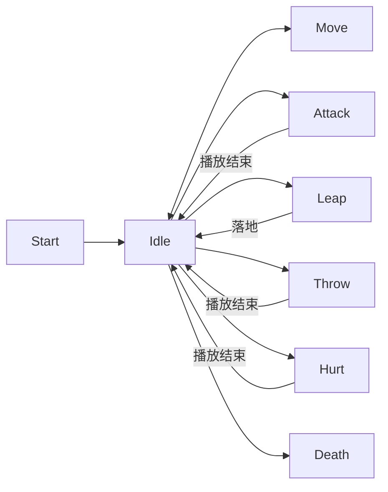

# 怪物系统

当前怪物系统由通用怪物模板、通用四状态 AI、数据驱动生成器、第一只示例怪物“给”和现有战斗组件组成。项目内所有怪物都应继承 `scenes/monsters/base_monster.tscn` 与 `BaseMonster`，行为参数写进 `EnemyAIConfig`；生成配置只负责“在哪刷、刷多少”，AI、攻击、生命与动画由模板、共享的 AI 组件和各怪物自己的 `EnemyAttack` 负责。

## 当前实现

- 当前唯一怪物是“给”：只刷新在森林、针叶林、热带雨林群系的可通行格子中，生成后可以跨群系追逐玩家。
- 每个已加载区块按 `MonsterSpawnData` 独立掷随机；同一种子、同一区块、同一个 `monster_id` 会得到稳定一致的候选位置。
- 生成器逐格尝试可通行位置，同一区块内已经占用的格子不会重复放怪。
- `GameWorld/MonsterSpawner` 已加入 `resources/monsters/give_spawn_data.tres`，所以普通游戏流程无需额外脚本接线。
- AI 是一套通用四状态机（`Patrol` / `Chase` / `Attack` / `Search`），所有怪物共用；`resources/monsters/give_ai_config.tres` 是“给”的数据配置。
- 多只怪物可以同时运行：每只怪物有自己的黑板、随机种子与冷却，共享配置、感知服务、路径调度与事件总线。

## 文件与职责

| 文件 | 职责 |
| --- | --- |
| `scripts/monsters/base_monster.gd` | 通用怪物模板：装配 AI 组件、动画推进、视线与地形采样、受击反馈、血条、死亡清理 |
| `scripts/monsters/ai/enemy_brain.gd` | 通用四状态状态机：Patrol / Chase / Attack / Search 与全部状态转换 |
| `scripts/monsters/ai/enemy_ai_config.gd` | `EnemyAIConfig` 数据配置：巡逻、感知、攻击、搜索、移动与性能参数 |
| `scripts/monsters/ai/enemy_blackboard.gd` | `EnemyBlackboard`：每只怪物一份的可变状态（目标、锚点、计时器） |
| `scripts/monsters/ai/enemy_perception.gd` | `EnemyPerception`：视野距离/锥角 + 无遮挡视线，并接收可疑信息 |
| `scripts/monsters/ai/enemy_navigator.gd` | `EnemyNavigator`：向共享调度器请求路径并逐帧跟随 |
| `scripts/monsters/ai/enemy_attack.gd` | `EnemyAttack` 攻击接口：能不能打、怎么打、前摇后摇 |
| `scripts/monsters/ai/enemy_pathfinder.gd` | 静态 A* 工具：地形与最近命中的物理墙体转格阻挡 |
| `scripts/monsters/ai/perception_manager.gd` | 自动加载感知服务：按帧预算分派视线评估，广播噪音/警报 |
| `scripts/monsters/ai/path_request_scheduler.gd` | 自动加载寻路服务：按帧预算执行 A*，结果异步回传 |
| `scripts/monsters/give_monster.gd` | “给”的专属脚本：血量与死亡流程、装配自己的攻击实现 |
| `scripts/monsters/give_monster_attack.gd` | “给”的攻击实现：6~10 格投石、6 格内跳跃近战 |
| `scripts/monsters/give_monster_visual.gd` | “给”的代码绘制占位外形，替换 `Visual/Placeholder` |
| `scripts/monsters/monster_spawner.gd` | 区块生成器：定义数组、确定性随机、按区块管理存活怪物 |
| `scripts/monsters/monster_spawn_data.gd` | 单种怪物的生成配置资源与 `can_spawn_at()` 校验 |
| `scenes/monsters/base_monster.tscn` | 所有怪物的继承起点，包含血条、受击区、视觉节点与动画节点 |
| `scenes/monsters/give_monster.tscn` | “给”的继承场景，覆盖专属脚本、动画库与外形 |
| `resources/monsters/give_spawn_data.tres` | “给”的生成配置：群系、概率、数量与尝试次数 |
| `resources/monsters/give_ai_config.tres` | “给”的 AI 配置：巡逻、视野、攻击、搜索与性能参数 |
| `resources/monsters/monster_animation_state_machine.tres` | 公共动画状态图 |
| `resources/monsters/base_animation_library.tres` | 通用模板的占位动画库 |
| `resources/monsters/give_animation_library.tres` | “给”使用的动画库，目前是占位动画的独立副本 |
| `resources/monsters/hit_flash.gdshader` | CanvasGroup 全身闪红着色器 |
| `tools/build_monster_animations.gd` | 重新生成或调整占位动画库与状态图 |
| `scripts/combat/health_component.gd` | 血量、防御、受伤与死亡信号 |
| `scripts/combat/combat_hurtbox.gd` | 受击区域、阵营和 HealthComponent 引用 |
| `scripts/combat/combat_hit.gd` | 单次命中的数据包 |
| `scenes/game/game_world.gd` / `.tscn` | 当前游戏世界的怪物生成接线、地图切换、掉落物保存与地图边界约束 |

## 场景结构

`base_monster.tscn` 以 `CharacterBody2D` 为根，继承它即可获得完整通用能力：

```text
BaseMonster (CharacterBody2D)
  Visual (CanvasGroup + hit_flash ShaderMaterial)
    Placeholder / 自定义外形
  AnimationPlayer
  AnimationTree
  Health (HealthComponent)
  Hurtbox (Area2D + CombatHurtbox)
    CollisionShape2D
  TargetRayCast (RayCast2D)
  CollisionShape2D
  NameLabel
  HealthBar
```

`Hurtbox` 使用 `collision_layer = 4`（EnemyHurtbox）、`team = 2`，并且 `monitoring = false`，只作为被动受击区域。名字与血条在 `Visual` 外面，所以全身闪红不会影响它们。

## 生成流程

1. `GameWorld._setup_map_monsters()` 调用 `MonsterSpawner.setup(generator, chunk_manager, player)`。
2. `setup()` 清空旧怪物，订阅 `ChunkManager.chunk_applied`，并立即为所有已加载区块生成怪物。
3. 每个区块内遍历 `spawn_definitions`；RNG 种子由世界种子、区块坐标和 `monster_id` 共同产生。
4. `MonsterSpawnData.can_spawn_at()` 要求当前格可通行，且当前格群系在 `allowed_biomes` 中或列表为空。
5. 生成成功时把怪物加入 spawner 子节点、`monsters` 存活数组和 `_monsters_by_chunk` 字典，并调用 `monster.configure(player, generator, chunk_coords)`。
6. `tree_exited` 一次性连接会从存活数组与区块字典移除怪物；死亡或外部清理后不会留下失效引用。

当前 `GameWorld` 会让整张地图长期加载，所以切图时调用 `setup()` 替换当前地图的存活怪物，并关闭 `MonsterSpawner._process()` 里的距离回收逻辑。生成器自带按 `unload_radius + despawn_margin_chunks` 回收怪物的设计，仍可用于未来的动态世界或独立测试。

本局击杀记录保存在 `MonsterSpawner._defeated_spawn_ids`，身份为 `monster_id + 原始生成格坐标`，巡逻或追击后的位置不会改变身份。`BaseMonster.kill()` 只在真正死亡时发出一次 `killed`；正常伤害死亡和 K 调试击杀都会记录，切图清理、距离回收、隐藏邻图裁剪则不会记录。重放区块的确定性生成序列时，死怪仍占用原有名额，所以返回旧箱庭既不会复活，也不会在另一个位置补刷替代怪物；未击杀的生成名额仍正常出现。连续调用 `setup()` 且使用同一生成器时保留记录，`build_world()` 创建新生成器时清空，包括使用相同种子重开一局。记录目前仅在本局内存中保存。

地图切换时，非怪物掉落物会保存到所属地图的 `MapEntities_<map_id>` 根节点；离开当前箱庭后隐藏并暂停，返回后恢复。每帧 `GameWorld._confine_map_monsters()` 会把怪物位置限制在当前地图矩形内，已加载的隐藏邻图也不会留下跨图怪物。

## 通用四状态 AI

`scripts/monsters/ai/` 下是一套所有怪物共用的状态机，只有四个状态，没有 Return / GoHome / Flee：

| 状态 | 进入条件 | 行为 | 离开条件 |
| --- | --- | --- | --- |
| `Patrol` | 默认状态 | 在 `PatrolAnchor` 半径内选可达点、寻路，到达后等待环顾再选下一个点 | 看到玩家 -> `Chase`；收到可疑信息 -> `Search` |
| `Chase` | 确认看到玩家 | 追向玩家当前位置或最后已知位置 | 进入攻击距离且可出手 -> `Attack`；丢失视野超过 `lose_sight_grace` -> 改写锚点后 `Patrol` |
| `Attack` | 在攻击距离内且可见 | 面向玩家，按冷却/前摇/后摇出手 | 离开攻击距离但仍可见 -> `Chase`；丢失视野超过宽限 -> 改写锚点后 `Patrol` |
| `Search` | 噪音、警报、被攻击但没看到玩家 | 在 `SearchCenter` 附近逐个搜索点移动、停留、环顾 | 搜索超时或走完所有点 -> 改写锚点后 `Patrol`；看到玩家 -> `Chase` |

硬性规则：**丢失玩家视野后不回出生点、不回原巡逻点**。`Chase` / `Attack` 的宽限计时一过，`EnemyBrain._lose_target()` 会把 `blackboard.patrol_anchor` 改写成怪物当时所在的位置、清空目标与搜索状态，再切回 `Patrol`，所以怪物会在“最后看到玩家的地方”附近继续巡逻；`Search` 结束时同样把锚点改写成当前位置。开启 `config.search_on_lost_sight` 时，`Chase` / `Attack` 丢失视野会先经过一次 `Search` 再回到 `Patrol`，锚点规则不变。

组件职责与共享边界：

- `EnemyBrain`：每只怪物一个实例，持有状态机、随机序列与分帧决策。
- `EnemyAIConfig`（`Resource`）：巡逻、感知、攻击、搜索、移动与性能参数。怪物进入场景树时会 `duplicate()` 一份自己的副本，所以多只怪物可以共享同一个 `.tres` 而不会互相污染。
- `EnemyBlackboard`：每只怪物一份，保存状态、目标、最后已知位置、`PatrolAnchor`、`SearchCenter`、各种计时器与朝向。怪物之间不共享任何可变状态。
- `EnemyPerception` / `EnemyNavigator` / `EnemyAttack`：统一感知、寻路与攻击接口；`EnemyAttack` 是抽象基类，新怪物覆写 `can_attack()` / `perform_attack()` 即可。
- `PerceptionManager`、`PathRequestScheduler`（自动加载）：所有怪物共享的感知与寻路服务，按帧预算分派，避免同一帧所有怪物一起做昂贵检测或 A*。
- `EventBus.noise_reported` / `EventBus.alert_raised`：噪音与警报走同一条通道，半径内的怪物会把它记为可疑信息，从而进入 `Search`。

可疑信息的来源（都汇入同一个 `report_suspicious()`，只影响 Patrol -> Search）：

- `EventBus.noise_reported`：噪音（脚步、投掷、爆炸等），由 `PerceptionManager` 转给半径内的怪物。
- `EventBus.alert_raised`：队友警报 / 警戒事件，与噪音同一条通道。
- 被攻击但看不到攻击者：`BaseMonster._on_monster_damaged()` 在 `EnemyPerception.can_see()` 为假时把受击来源位置记为可疑信息；这里用感知判定，所以"视线被挡"和"超出视野距离"两种情况都会触发搜索。

初始巡逻锚点（`PatrolAnchor`）：怪物场景里存在名为 `PatrolAnchor` 的子节点时用它的位置（配置点 / 房间中心），否则用出生点。之后只有"丢失目标"和"搜索结束"两种情况会改写锚点。

确定性与性能：

- 每只怪物的随机种子由所在世界的 `world_generator.world_seed`、生成格坐标、`ai_id` 与区块坐标共同产生，同一局存档 / 回放的巡逻点与搜索点一致。
- 感知、决策与寻路请求按 `update_interval` / `perception_interval` 分帧，并用确定性随机做 stagger 打散。
- 超过 `lod_distance_tiles` 的怪物进入 LOD：感知与决策间隔、以及路径刷新间隔都乘以 `lod_interval_scale`，动画降到 `lod_animation_hz`。
- 路径失败或选不到巡逻点时会进入等待，按 `path_failure_retry_delay` 重试，不会卡墙。
- **决策与动作必须分层**：`_decide_*()` 按 `update_interval`（再乘 LOD 倍率）分帧，`_act_*()` 每帧执行，而等待计时是每帧递减的。因此 `_act_*()` 绝不能因为"当前没有路径"就重置等待或推进选点——那会在下一个决策帧到来之前反复重置计时，怪物永远等不到"空闲且等待结束"的决策帧，表现为完全不巡逻。寻路失败统一由决策层用 `EnemyNavigator.consume_failed_request()` 处理。

## 感知、寻路与地形

- 视线检查由两部分组成：`TargetRayCast` 检测物理墙体，另按每 1/4 格密集采样 `world_generator.is_walkable()` 弥补 TileSet 当前没有物理碰撞层的问题。
- 移动使用局部 `AStarGrid2D`：区域以起点和目标为中心向外扩展 `path_margin_tiles`，并把不可通行地形以及最近一次 RayCast 命中的物理墙体转成格阻挡。
- 默认只允许 `world_generator.is_walkable(tile)`；子类可覆写 `is_navigation_tile_allowed()` 追加限制。
- 击退与跳跃这类“整段位移”会用 `is_terrain_segment_clear()` 逐格检查线段扫过的所有格子（含只擦过一角的格子），保证不会擦着墙角穿过墙体。
- `clear_player_aggro()` 会立刻放弃目标、清空路径与搜索状态，并以当前位置为锚点回到 `Patrol`。

## “给”的行为

“给”只提供数据配置与攻击实现，状态流程由 `EnemyBrain` 统一驱动：

- `resources/monsters/give_ai_config.tres`：10 格视野、10 格攻击距离、1 秒攻击冷却、2.5 秒丢失视野宽限、`search_on_lost_sight = false`（丢失视野直接回 `Patrol`）、移动速度 72、决策间隔 0.1 秒、LOD 距离 14 格。
- `GiveMonsterAttack`（`scripts/monsters/give_monster_attack.gd`）：距离 6 到 10 格（包含两端）时寻找 1 格内仍在 `throwable_stones` 组且实现 `throw_at(target, damage)` 的石子，找到则播放 `Throw` 并投掷，造成 1 点伤害；距离 < 6 格时，在落点可走、整段位移不穿墙且落点视线无遮挡时发起跳跃，跳跃时长 0.42 秒，动画在 0.21 秒处把 `_visual_height` 抬到 24 像素，落点由脚本插值处理，结束且与玩家距离 <= 2 格时造成 1 点近战伤害。
- 远程攻击时附近没有石子则本次出手失败，按 0.3 秒失败重试，不会切换到跳跃；当前地图还没有正式石子，因此这个分支会保持等待。
- 受击会打断跳跃并清空出手意图，旧位移不会覆盖击退；看不到攻击者时会把受击位置记为可疑信息，交给 `Search` 处理而不是直接回家。

投石接口不依赖具体石子类型。正式石子应该沿用 `IngredientData` / `IngredientModel`，进入 `throwable_stones` 组并实现 `throw_at`，怪物代码不需要知道石子种类。

## 受击、击退与死亡

受击链路为：武器/攻击生成 `CombatHit` -> `CombatHurtbox` 过滤阵营与存活状态 -> 同一个 `HealthComponent` 统一扣血 -> 血条与怪物回调：

- `HealthComponent.receive_hit()`：`实际伤害 = max(0, 伤害 - 防御)`，最多扣到当前生命；扣血后才发出 `damaged`，生命归零时再发出 `died`。
- 同阵营不受伤；一个角色的多个 `Hurtbox` 应引用同一个 `HealthComponent`，武器命中名单也按 `HealthComponent` 去重。
- `BaseMonster` 收到 `damaged` 后进入 `Hurt`、重置 0.06 秒全身闪红，并按 `CombatHit.knockback` 计算 0.10 秒击退。
- 击退强度为 `武器击退 + 同方向模板基础击退速度`；没有武器击退向量时按攻击来源位置推出，只使用模板默认 40 像素/秒。
- 击退按小步移动，并同时检查程序化地形与物理碰撞，不会穿过墙体；连续受击会重置反馈时间。
- 子类调用 `super._physics_process()` 后应检查 `is_receiving_knockback()`，优先跳过自己的移动或攻击，避免 AI 覆盖击退位移。
- 死亡会进入 `Death` 并 `queue_free()`，目前不等待死亡动画播完；`kill()` 会把已经带在身上的 `ingredients` / `throwable_stones` 子节点先移到世界父节点，避免随怪物一起销毁。

调试输入 `K` 会调用 `GameWorld.kill_monsters_in_tree()`，只处理 `monsters` 组并调用 `kill()`，不直接操作掉落物或其他实体。

## 动画

状态图包含 `Idle`、`Move`、`Attack`、`Leap`、`Throw`、`Hurt`、`Death`，仅保留12条转换：`Start → Idle`；`Idle ↔ Move/Attack/Leap/Throw`；`Idle → Hurt → Idle`；`Idle → Death`。`Death` 没有出边，脚本也拒绝从它切回其他状态。`Idle` 和 `Move` 循环；`Attack`、`Throw`、`Hurt` 播放结束后自动回到 `Idle`；`Leap` 由“给”在逻辑落地后切回 `Idle`。



`play_monster_animation()` 对存在直连的普通状态使用 `travel()`；受击、死亡、重启动作或没有直连的目标使用 `start()` 立即切换，避免经由 `Idle` 间接应用其他动画轨道。受击和死亡因此可以打断任意存活动作，无需在图上再增加交叉连线。

占位动画只用三个根节点属性驱动外观：

- `visual_pose`：身体位移与受击抖动。
- `_visual_height`：跳跃高度，用于把整个 `Visual` 抬离落点。
- `visual_tint`：受击颜色乘算，播放后恢复白色。

所有动画都在 `AnimationTree` 上切换，由 `BaseMonster.advance_monster_animation()` 手动推进，确保物理帧、AI 和动画处于同一节奏。`tools/build_monster_animations.gd` 可完整生成默认资源，使用 `--hurt-only` 仅替换受击动画，使用 `--state-machine-only` 仅更新精简状态图并保留原UID，不覆盖怪物已经编辑的动画库。

## 添加新怪物

1. 在 Godot 文件系统中右键 `scenes/monsters/base_monster.tscn`，选择“新建继承场景”，保存为新的怪物场景。
2. 修改 `NameLabel.text`、`Health.max_health` 和碰撞形状；在 `Visual` 下隐藏 `Placeholder` 并添加自己的精灵或代码绘制外观。可选：加一个名为 `PatrolAnchor` 的 `Node2D` 子节点作为初始巡逻锚点，不加以出生点为锚点。
3. 为根节点绑定 `extends BaseMonster` 的专属脚本，并指定一份 `EnemyAIConfig`（复制 `resources/monsters/give_ai_config.tres` 改数值即可）：巡逻半径、视野距离/锥角、攻击距离、丢失视野宽限、搜索时长、移动速度、LOD 等全部走配置。需要新攻击方式时覆写 `_create_attack()` 返回自己的 `EnemyAttack`；覆写 `_ready()` / `_physics_process()` 时调用对应 `super`。
4. 为新怪物创建或复制独立动画库，保留 `Idle`、`Move`、`Attack`、`Hurt`、`Death` 名称；需要特殊技能时使用 `Leap`、`Throw`。若要修改状态图，先把 `AnimationTree.tree_root` 改为独立资源，避免影响其他怪物。
5. 创建 `MonsterSpawnData` 资源：填写 `monster_id`、`monster_scene`、`allowed_biomes`、`chunk_spawn_chance`、`max_per_chunk`、`candidate_attempts`。
6. 把新数据加入 `scenes/game/game_world.tscn` 中 `MonsterSpawner.spawn_definitions` 数组。

新增怪物不需要修改生成器脚本，也不需要复制 AI：状态机、感知与寻路都是共享的，差异只在 `EnemyAIConfig` 与 `EnemyAttack`。如果需要完全不同的感知或移动规则，优先在 `EnemyPerception` / `EnemyNavigator` 上追加通用接口，避免新怪物直接依赖“给”的实现。

## 测试

怪物相关回归包括模板生命周期、四状态 AI、动画、受击反馈、闪红渲染、世界生成与“给”的完整行为：

```powershell
godot --headless --path . res://tests/test_monster_hit_effects.tscn
godot --path . res://tests/test_hit_flash_render.tscn --rendering-method gl_compatibility
godot --headless --path . res://tests/test_monster_animations.tscn
godot --headless --path . res://tests/test_monster_persistence.tscn
godot --headless --path . res://tests/test_enemy_ai.tscn
godot --headless --path . res://tests/test_give_monster.tscn
godot --headless --path . res://tests/test_rainforest_spawner.tscn
```

`test_give_monster.tscn` 可加 `-- --navigation-only` 只跑程序化地形与物理墙的绕行测试。地图切换、掉落物挂靠、跨图保存和世界重建由 `tools/test_map_integration.gd` 覆盖。

## 已知限制与后续建议

- 当前只配置了“给”一种怪物，尚无掉落、经验、Boss、精英或按关卡配置的战斗内容。
- 当前没有正式可拾取石子，“给”的远程分支依赖未来的 `throwable_stones` 实现。
- 地形阻挡仍以代码判定为主，TileSet 未配置物理碰撞层；寻路会把最近一次的物理墙体转为格阻挡。
- `GameWorld` 使用整图加载，因此关闭了生成器的距离回收；如果要做开放世界，需要重新评估 `MonsterSpawner._process()` 与地图预加载的配合。
- 死亡动画只短暂进入后立即清理节点，后续播放完整死亡动画、掉落结算和移除碰撞需要继续实现。
- 视线与巡逻选点仍用每 1/4 格密集采样判断地形，`is_terrain_segment_clear()` 对击退、跳跃这类整段位移做逐格检查；两者在极浅的擦角处口径略有差异。
- 目前没有“最后已知位置”之外的记忆（脚印、仇恨表等）：怪物丢失目标后只会在最后位置附近搜索或巡逻。接入仇恨/警戒等级时应保持四状态转换与锚点规则不变。
